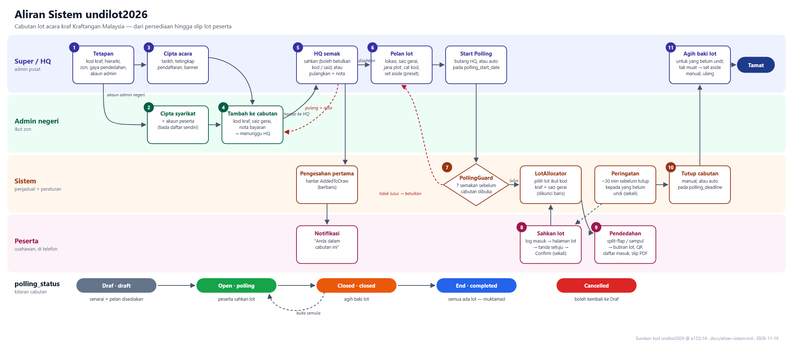
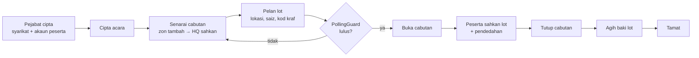
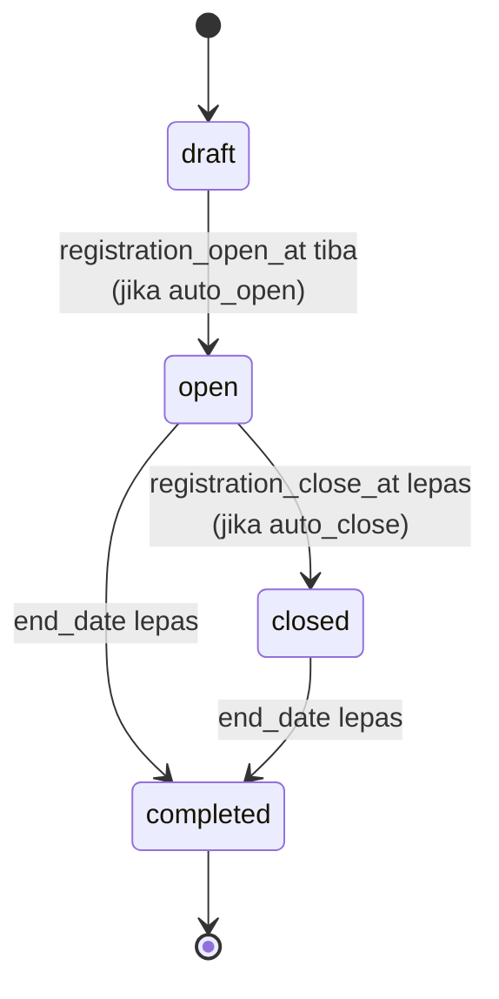
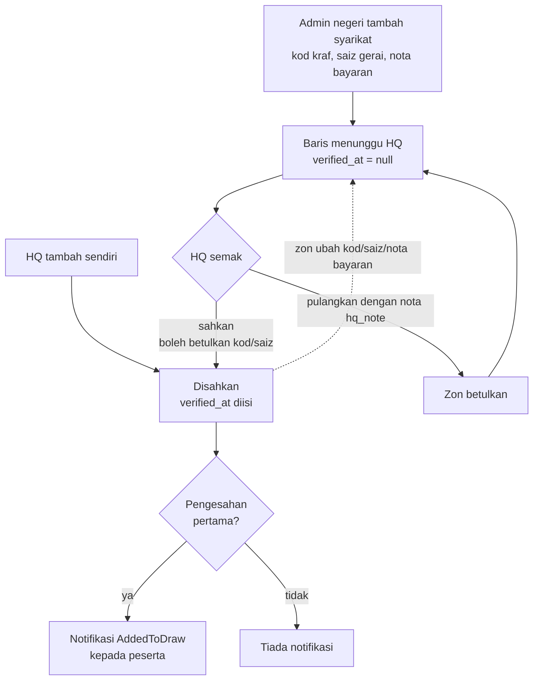
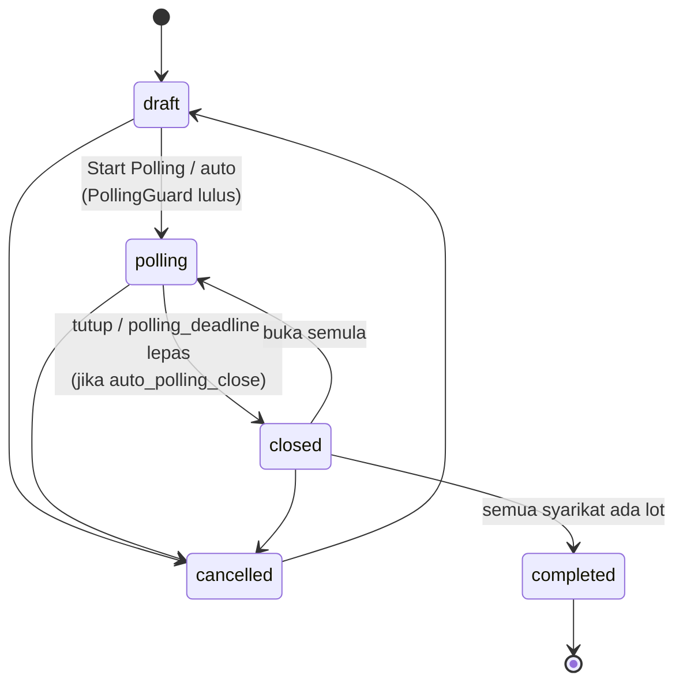
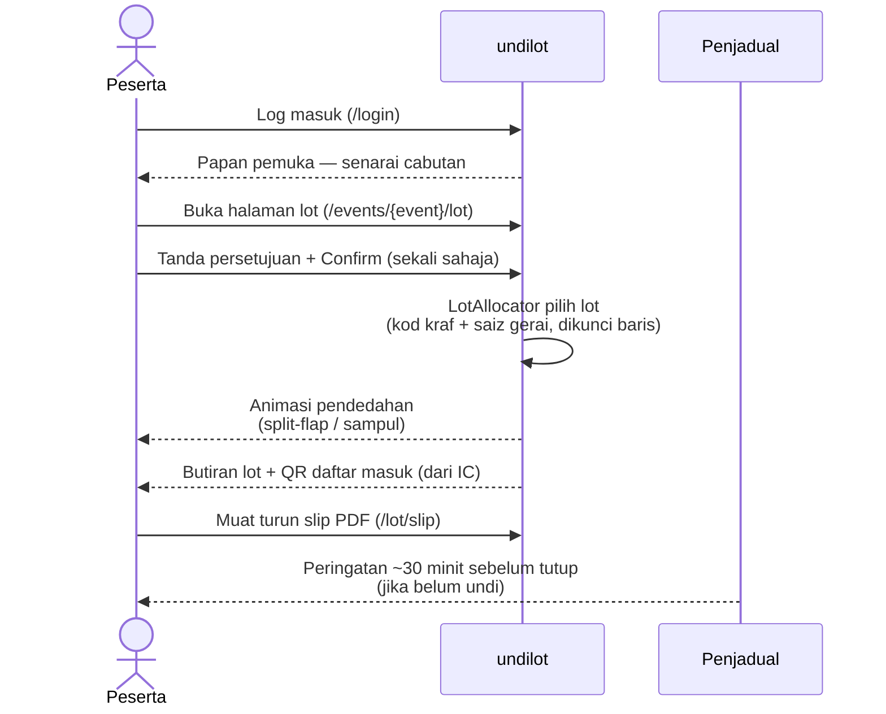

# Aliran Sistem undilot2026

*Disediakan 2026-11-16 daripada kod pada commit `a152c14`. Jika kod berubah, kod
yang betul — kemas kini dokumen ini.*

Dokumen ini menerangkan **siapa buat apa, mengikut urutan**, dari acara dicipta
sehingga peserta memegang slip lotnya. Peraturan terperinci dan sebab di
sebaliknya ada dalam `CLAUDE.md`; pengguna dan tujuan produk dalam `PRODUCT.md`.

---

## 1. Pelakon

| Pelakon | Log masuk | Skop |
|---|---|---|
| **Super admin** | `/admin/login` | Semua. Satu-satunya yang mengurus akaun HQ. |
| **Admin HQ** | `/admin/login` | Semua zon. Menyemak semula (sahkan) senarai cabutan, mengurus admin negeri, membuka/menutup cabutan. |
| **Admin negeri (zon)** | `/admin/login` | Syarikat dan baris cabutan zonnya sahaja. Nampak setiap acara yang bukan draf. |
| **Peserta (usahawan)** | `/login` | Cabutan syarikatnya sendiri. Akaun dicipta oleh pejabat — **tiada pendaftaran sendiri**. |
| **Pelawat** | — | Senarai acara awam dan halaman setiap acara. |
| **Penjadual (cron)** | — | `events:update-statuses` dan `voting:send-reminder`, setiap minit. |

---

## 2. Aliran keseluruhan

---

## 3. Persediaan (sekali, sebelum acara)

1. **Tetapan** (super/HQ) — *Setting*:
   - Senarai juntai bawah, zon (`/admin/settings/lists`)
   - Kod kategori kraf — TBPS, RKP… (`/admin/settings/kraf-codes`)
   - Hierarki kraf: 5 kategori → sub-bidang → pengelasan → produk (`/admin/settings/kraf-hierarchy`)
   - Gaya pendedahan lot: papan *split-flap* atau sampul bermeterai, satu pilihan untuk semua acara (`/admin/settings/lot-draw`)
2. **Akaun admin** — super mencipta admin HQ; HQ mencipta admin negeri dan menetapkan zonnya (`/admin/admins/...`). Akaun admin boleh dimatikan: tidak boleh log masuk, sesi terbuka ditamatkan.
3. **Syarikat** (`/admin/companies`) — pejabat mencipta rekod syarikat; **akaun peserta dicipta bersama** daripada rekod syarikat. Pejabat menanda pengelasan/produk kraf dan kod kraf biasa syarikat (hanya admin nampak kod).

---

## 4. Acara

Acara mempunyai **dua status yang bergerak berasingan**:

| Lajur | Maksud | Nilai |
|---|---|---|
| `status` | Adakah acara diterbitkan | `draft` (Draf) → `open` (Published) → `closed` (Unpublished) → `completed` (Ended) |
| `polling_status` | Sejauh mana cabutan berjalan | `draft` → `polling` (Open) → `closed` → `completed` (End); `cancelled` |

Acara dicipta di `/admin/events/create`. Penjadual mengubah `status` mengikut tarikh:

Admin negeri tidak nampak acara `draft`.

---

## 5. Senarai cabutan — dua semakan

Halaman: `/admin/events/{event}/registrations`. Tiada borang permohonan —
**pejabat memasukkan setiap syarikat**.

Peraturan penting:

- **Peserta tidak diberitahu dan tidak nampak cabutan** sehingga HQ mengesahkan
  buat kali pertama (`first_verified_at`). Selepas itu syarikat kekal dalam
  portalnya walaupun baris disemak semula.
- **HQ boleh memintas zon** — syarikat yang HQ tambah terus disahkan. Ini
  keputusan reka bentuk, bukan pepijat.
- Perubahan kod, saiz atau nota bayaran oleh zon **mengosongkan pengesahan**;
  baris kembali menunggu HQ.
- **Membuang baris:** zon hanya boleh membuang baris yang belum diberitahu dan
  belum memegang lot. Baris yang sudah diberitahu hanya HQ boleh buang, dan
  peserta menerima `RemovedFromDraw` beserta sebab.
- **Selepas cabutan bermula** (`polling_status` ≠ `draft`): kod dan saiz
  dibekukan untuk semua termasuk HQ; zon tidak boleh menambah sesiapa; HQ masih
  boleh menambah peserta lewat (terus disahkan).

---

## 6. Pelan lot

Halaman: `/admin/polling` → **Create** (dua halaman: tetapan, kemudian pelan).

1. **Tetapan cabutan** — acara, tetingkap undian (`polling_start_date`,
   `polling_deadline`), buka/tutup automatik, guna *preset* atau tidak.
2. **Pelan** — lokasi; setiap lokasi memegang beberapa saiz gerai, dengan
   peruntukan kod kraf.
3. **Jana plot** (`generate-plots`), kemudian **cat kod** pada plot jika perlu
   (`/admin/polling/{event}/paint`).
4. **Set aside (preset)** — pilihan: simpan satu lot untuk satu syarikat sebelum
   cabutan. Lot ini kekal rahsia — kepada syarikat dan admin zonnya — sehingga
   syarikat menekan Confirm.

Pelan **dibekukan** sebaik lot pertama dipegang.

---

## 7. Buka cabutan — PollingGuard

Cabutan dibuka melalui butang *Start Polling* atau secara automatik oleh
penjadual pada `polling_start_date` (jika `auto_polling_open`). **Kedua-dua
pintu menjalankan semakan yang sama** (`app/Support/PollingGuard.php`). Cabutan
ditolak jika:

1. Tiada tarikh tamat (`polling_deadline`)
2. Tiada plot dicipta
3. Ada baris belum disahkan HQ
4. Ada syarikat tanpa akaun peserta
5. Ada baris tanpa kod kraf
6. Ada kod kraf tanpa plot untuk dimenangi (melebihi plot tanpa kod yang ada)
7. Saiz gerai tidak cukup lot

Jika auto-buka ditolak, acara kekal `draft` dengan suis masih hidup — ia dibuka
sendiri sebaik masalah dibetulkan (amaran direkod dalam log).

---

## 8. Peserta mengesahkan lot

- Confirm hanya sekali; klik berganda ditahan oleh kunci pangkalan data.
- Jika kod kraf peserta belum ditetapkan, peserta diminta menghubungi pejabat.
- Syarikat yang ada lot *preset* menerima lot itu bila menekan Confirm.
- Notifikasi (AddedToDraw, RemovedFromDraw, VotingCloseReminder) muncul dalam
  portal di `/notifications`.

---

## 9. Tutup dan agih baki

1. Cabutan ditutup — manual, atau automatik pada `polling_deadline`.
2. Admin tekan **Assign remaining lots** (`/admin/polling/{event}/process`) —
   hanya pada cabutan `closed`. Algoritma meletakkan setiap syarikat yang belum
   undi.
3. Jika ada yang tidak dapat diletakkan, cabutan **kekal `closed`** dan nama
   mereka dipaparkan. Admin guna *Set aside* pada plot kosong, kemudian tekan
   *Assign remaining lots* sekali lagi.
4. Bila setiap syarikat ada lot → ubah status ke **`completed`**. Tiada jalan
   balik dari `completed`.

---

## 10. Awam

| Halaman | Route |
|---|---|
| Laman utama — senarai acara diterbitkan | `/` |
| Halaman acara (maklumat sahaja; tiada borang) | `/events/{event}` |
| Acara lepas | `/past-events` |

Peringkat yang pelawat nampak: **soon → open → closed → now → ended**, dibaca
daripada tarikh acara dan status cabutan (`Event::publicStage()`).

---

## 11. Notifikasi dan kerja latar

| Pencetus | Notifikasi / tindakan | Penerima |
|---|---|---|
| HQ mengesahkan baris buat kali pertama | `AddedToDraw` | Peserta |
| Baris yang sudah diberitahu dibuang | `RemovedFromDraw` (dengan sebab) | Peserta |
| Cabutan dibuka, tutup dalam 25–35 minit, peserta belum undi | `VotingCloseReminder` (sekali, `reminded_at`) | Peserta |
| Setiap minit | `events:update-statuses` — status acara + buka/tutup cabutan automatik | — |

Semua notifikasi **berbaris** (`QUEUE_CONNECTION=database`). Pada produksi
pekerja baris gilir mesti berjalan; pada dev tempatan tekan *Work the queue* di
`/auto`.
