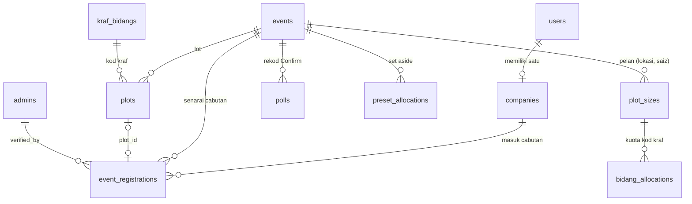

# Panduan Serahan Pembangun — undilot2026

*Disediakan 2026-11-16 daripada kod pada commit `a152c14`. Untuk pembangun yang
mengambil alih projek ini **tanpa sebarang pengetahuan awal**.*

Baca dokumen ini dahulu, dari atas ke bawah. Selepas itu:

1. [`docs/aliran-sistem.md`](aliran-sistem.md) — aliran sistem bergambar
2. [`PRODUCT.md`](../PRODUCT.md) — siapa pengguna dan kenapa sistem ini wujud
3. [`CLAUDE.md`](../CLAUDE.md) — **semua** peraturan dan keputusan reka bentuk, dengan sebabnya
4. [`DESIGN.md`](../DESIGN.md) — sistem reka bentuk (warna, fon, komponen)

Ruangan bertanda **[PERLU DIISI]** ialah maklumat yang tidak ada dalam repo;
pemilik projek perlu melengkapkannya.

---

## Kandungan

1. [Ringkasan satu minit](#1-ringkasan-satu-minit)
2. [Istilah](#2-istilah)
3. [Sejarah projek](#3-sejarah-projek)
4. [Teknologi](#4-teknologi)
5. [Pasang di mesin sendiri](#5-pasang-di-mesin-sendiri)
6. [Akaun dan log masuk](#6-akaun-dan-log-masuk)
7. [Peta folder](#7-peta-folder)
8. [Model data](#8-model-data)
9. [Aliran utama secara ringkas](#9-aliran-utama-secara-ringkas)
10. [Peraturan yang tidak boleh dilanggar](#10-peraturan-yang-tidak-boleh-dilanggar)
11. [Cara buat tugas biasa](#11-cara-buat-tugas-biasa)
12. [Ujian](#12-ujian)
13. [Deploy ke produksi](#13-deploy-ke-produksi)
14. [Data lama dan import](#14-data-lama-dan-import)
15. [Isu diketahui dan kerja belum selesai](#15-isu-diketahui-dan-kerja-belum-selesai)
16. [Senarai semak hari pertama](#16-senarai-semak-hari-pertama)
17. [Hubungan](#17-hubungan)

---

## 1. Ringkasan satu minit

**undilot2026** ialah sistem **cabutan lot gerai** untuk acara/pameran kraf
anjuran Kraftangan Malaysia.

- **Pejabat** (admin) memasukkan syarikat usahawan ke dalam senarai cabutan
  sesuatu acara, menyediakan pelan gerai, kemudian membuka cabutan.
- **Usahawan** (peserta) log masuk — kebanyakannya di telefon — menekan
  **Confirm**, dan sistem memilih lot gerai untuk mereka mengikut kod kraf dan
  saiz gerai. Lot didedahkan dengan animasi; peserta dapat kod QR daftar masuk
  dan slip PDF.
- Selepas cabutan ditutup, pejabat mengagihkan baki lot kepada yang belum
  menekan Confirm.

Peserta **tidak mendaftar atau memohon sendiri**. Semua data dimasukkan oleh
pejabat.

---

## 2. Istilah

Projek ini bercampur Bahasa Melayu dan Inggeris dalam kod. Senarai ini memetakan
kedua-duanya.

| Istilah | Dalam kod | Maksud |
|---|---|---|
| Acara | `Event`, `events` | Pameran/karnival kraf. Ada tarikh, lokasi dan satu cabutan. |
| Cabutan lot / undian | *polling*, `polling_status`, `zvote` | Proses peserta mendapat lot gerai. "Polling" dan "vote" dalam kod = cabutan, bukan undi pilihan raya. |
| Senarai cabutan | `EventRegistration`, `event_registrations` | Senarai syarikat yang menyertai cabutan sesuatu acara. Satu baris = satu syarikat dalam satu acara. Nama "registration" warisan; tiada pendaftaran sendiri. |
| Lot / plot / gerai | `Plot`, `plots` | Satu ruang gerai fizikal. `plot_code` = label bercetak (cth. `TBP01`). |
| Pelan lot | `PlotSize`, `BidangAllocation` | Susun atur: lokasi (Khemah A, Basement…), saiz gerai (3x3…) dan berapa plot bagi setiap kod kraf. |
| Saiz gerai | `plot_size` (string, cth. `3x3`) | Saiz gerai yang syarikat perlukan. Lot hanya dipadankan pada saiz yang sama. |
| Kod kraf | `code`, `kraf_code`, `KrafBidang::codes()` | Kod seperti `TBPS`, `RKP` daripada helaian pengekodan HKK 2025. Lot dipadankan mengikut kod ini. |
| Kategori kraf | `KrafBidang::categories()` | 5 kategori tetap (Tekstil, Hasil Rimba…). **Tidak berkait** dengan kod kraf. |
| Zon | `state`, `AdminZones` | Zon pejabat negeri (bukan geografi tepat). Admin negeri hanya nampak syarikat zonnya. |
| Preset / set aside | `PresetAllocation`, `allocation_type = 'preset'` | Lot yang disimpan untuk satu syarikat sebelum cabutan. |
| Disahkan HQ | `verified_at`, `first_verified_at` | Baris senarai cabutan yang HQ sudah semak. |
| Pendedahan | *reveal*, `Setting › Lot Draw` | Animasi papan *split-flap* atau sampul bermeterai. |
| `daftar` | — | Sistem induk lama yang besar; projek ini dipecah daripadanya. |

---

## 3. Sejarah projek

```
daftar  (sistem besar: 285 route, 156 migration)   — arkib, f:\herd\daftar
  └─ 2026-10-13  undilotlook  (cabutan lot sahaja)  — github.com/aijad89/undilotlook
        └─ 2026-11-13  undilot2026  (5 modul)       — github.com/aijad89/undilot2026  ← repo ini
```

Yang **dibuang** dalam undilot2026: pengumuman, halaman footer, pautan sosial,
skrin jejak audit, laporan CSV dan modul permohonan sertai (lihat
`docs/superpowers/specs/2026-11-14-buang-permohonan-sertai-design.md`).
Jejak audit masih **direkod** ke pangkalan data; cuma tiada skrin.

Jika anda perlukan sesuatu yang pernah wujud, cari dalam `daftar` atau
`undilotlook` dan salin — jangan tulis semula. Baca "Bila menyalin daripada
`daftar`" dalam `CLAUDE.md` dahulu.

Semua 64 commit setakat ini dibuat oleh `aijad89`.

---

## 4. Teknologi

| Lapisan | Pilihan |
|---|---|
| Bahasa | PHP `^8.4` |
| Rangka kerja | Laravel 12 |
| Paparan | Blade, **tiada langkah bina** (tiada Vite/npm build/Alpine). CSS sebaris dalam partial Blade; Bootstrap 5.3.3 + Bootstrap Icons 1.11.3 dari CDN. |
| Pangkalan data | MySQL 8 (dev + produksi menurut `CLAUDE.md`); SQLite dalam-memori untuk ujian; SQLite fail juga berfungsi untuk dev tempatan |
| PDF | `barryvdh/laravel-dompdf` (slip lot) |
| QR | `endroid/qr-code` (QR daftar masuk) |
| Imej | `intervention/image` (sepanduk acara) |
| Ujian | Pest 4 (unit/feature), Playwright (pelayar, perlukan MySQL) |
| Baris gilir | `database` — semua notifikasi berbaris |
| Penjadual | Laravel scheduler, 2 arahan setiap minit |
| Zon waktu | `Asia/Kuala_Lumpur` (`config/app.php`) |

Node **tidak** diperlukan pada produksi — hanya untuk Playwright.

---

## 5. Pasang di mesin sendiri

### Keperluan

- PHP 8.4 dengan sambungan `pdo_mysql`, `pdo_sqlite`, `mbstring`, `gd`, `zip`, `bcmath`
- Composer
- MySQL 8 (pilihan; SQLite cukup untuk mula)
- Node 20+ (hanya jika menjalankan Playwright)

### Langkah

```bash
git clone https://github.com/aijad89/undilot2026.git
cd undilot2026
composer install
cp .env.example .env
php artisan key:generate
```

Edit `.env`:

```dotenv
APP_URL=http://127.0.0.1:8000

# Pilihan A — SQLite (paling cepat)
DB_CONNECTION=sqlite
# kemudian: buat fail kosong database/database.sqlite

# Pilihan B — MySQL (sama seperti produksi)
# DB_CONNECTION=mysql
# DB_HOST=127.0.0.1
# DB_PORT=3306
# DB_DATABASE=undilot2026        # utf8mb4_unicode_ci
# DB_USERNAME=...
# DB_PASSWORD=...

# Wajib — seeder enggan berjalan tanpanya (tiada kata laluan lalai, dengan sengaja)
ADMIN_SEED_USERNAME=admin
ADMIN_SEED_PASSWORD=<kata laluan kuat>
```

Kemudian:

```bash
php artisan migrate:fresh --seed     # skema + data rujukan + data demo (bukan produksi)
php artisan storage:link             # untuk sepanduk acara
php artisan serve                    # http://127.0.0.1:8000
```

`migrate:fresh --seed` di luar produksi menanam data demo: hierarki kraf
contoh, admin HQ + 14 admin negeri, peserta dengan syarikat, dan beberapa acara.
Ia mengambil kira-kira satu minit.

### Baris gilir dan penjadual di mesin sendiri

- Notifikasi berbaris dan **tidak akan dihantar** tanpa pekerja. Sama ada
  jalankan `php artisan queue:work`, atau tekan **Work the queue** di `/auto`.
- Untuk menguji buka/tutup automatik: `php artisan schedule:work`, atau jalankan
  `php artisan events:update-statuses` dengan tangan.
- `MAIL_MAILER=log` — aplikasi tidak menghantar emel langsung (notifikasi
  dalam aplikasi sahaja, keputusan pemilik 2026-11-17).

---

## 6. Akaun dan log masuk

Sistem ada **dua guard berasingan** — admin dan peserta tidak berkongsi sesi.

| Siapa | URL | Model / guard |
|---|---|---|
| Admin (super, hq, negeri) | `/admin/login` | `App\Models\Admin`, guard `admin` |
| Peserta | `/login` (ID Komuniti + IC) | `App\Models\User`, guard `web` |
| Log masuk pantas (dev sahaja) | `/auto` | Klik mana-mana akaun, tanpa kata laluan |

- Admin pertama dicipta oleh `AdminSeeder` daripada `ADMIN_SEED_USERNAME` /
  `ADMIN_SEED_PASSWORD`. Ia peranan `super`.
- `/auto` hanya didaftar bila `APP_ENV` ialah `local`, `testing` atau `e2e`
  (`routes/web.php`). **Ia tidak pernah wujud di pelayan.** Pastikan
  `APP_ENV=production` di produksi.

### Peranan admin

| Peranan | Kod | Boleh |
|---|---|---|
| Super | `super` | Semua, termasuk akaun HQ dan zon |
| HQ | `hq` | Acara, cabutan, tetapan, sahkan senarai cabutan, urus admin negeri |
| Admin negeri | `admin` | Syarikat dan senarai cabutan **zonnya sahaja** |

Gate ditakrif dalam `app/Providers/AppServiceProvider.php`: `manage-events`,
`manage-settings`, `manage-admins`, `verify-draw-list` (semuanya super/hq).

---

## 7. Peta folder

```
app/
├── Console/Commands/      Arahan artisan: penjadual, import CSV, import data lama
├── Exceptions/            LotUnavailable — kegagalan kongsi pengalokasi lot
├── Http/
│   ├── Controllers/
│   │   ├── Admin/         Semua skrin admin (acara, senarai cabutan, cabutan, tetapan…)
│   │   ├── Auth/          Log masuk peserta (ID Komuniti + IC), admin (nama pengguna + kata laluan)
│   │   ├── HomeController         Laman awam + papan pemuka peserta
│   │   ├── LotDrawController      Halaman lot peserta, Confirm, slip PDF
│   │   ├── NotificationController Peti notifikasi peserta
│   │   └── DevAutoLoginController /auto (dev sahaja)
│   └── Middleware/        Akaun dimatikan → keluar; jejak kehadiran admin
├── Models/                Eloquent (lihat seksyen 8)
├── Notifications/         AddedToDraw, RemovedFromDraw, VotingCloseReminder
├── Providers/             AppServiceProvider — gate, view composer, tetapan model
├── Services/              LotAllocator (peraturan lot), PlotAllocationAlgorithm (agih baki)
├── Support/               PollingGuard, EventVisibility, AdminZones, ManagedList, …
└── Traits/Auditable.php   Rekod jejak audit pada setiap perubahan model

database/
├── migrations/0001_01_02_000000_create_undilot_schema.php   ← SATU fail skema
└── seeders/               AdminSeeder, KrafCodeSeeder (rujukan); Demo*; E2eSeeder

resources/views/
├── admin/                 Skrin admin (reka bentuk .mac-, amber)
├── zvote/                 Halaman lot peserta + animasi pendedahan
├── layouts/               admin, frontend (peserta), public, user-auth
├── partials/              Gaya, bar navigasi, kad acara…
└── pdf/lot-result         Slip lot

routes/
├── web.php                Semua route
└── console.php            Penjadual (2 arahan setiap minit)

tests/
├── Feature/               ~65 fail Pest, dinamakan sebagai ayat ("ADrawOpensOnlyIfItCanFinish")
├── Regression/            Ujian tanpa RefreshDatabase
├── Unit/
└── e2e/                   Playwright (MySQL)

docs/                      Dokumen ini, aliran sistem, spec/pelan, manual ujian (xlsx)
```

---

## 8. Model data

Semua jadual aplikasi dicipta dalam **satu** fail:
`database/migrations/0001_01_02_000000_create_undilot_schema.php`.



| Jadual | Untuk apa |
|---|---|
| `admins` | Akaun admin; `role` = super/hq/admin, `state` = zon, boleh dimatikan |
| `users` | Akaun peserta (satu orang) |
| `companies` | Syarikat peserta. **Satu user = satu syarikat** (unique). Membawa `state` (zon), `kraf_code` cadangan, `plot_size` biasa |
| `events` | Acara. Dua status: `status` (terbit) dan `polling_status` (cabutan) |
| `event_registrations` | Senarai cabutan. `code` (kod kraf, **string**, bukan FK), `plot_size`, `plot_id` (lot yang dimenangi), `verified_at`, `first_verified_at`, `hq_note`, `payment_note`, `confirmed_at`, `reminded_at` |
| `plot_sizes` | Baris pelan = pasangan (lokasi, saiz) dengan kuantiti |
| `bidang_allocations` | Berapa plot bagi setiap kod kraf dalam satu baris pelan |
| `plots` | Lot sebenar. `plot_code`, `bidang_id` (kod kraf), `allocated_to`, `allocation_type` |
| `polls` | Rekod peserta yang sudah menekan Confirm |
| `preset_allocations` | Lot yang disimpan untuk syarikat sebelum cabutan |
| `kraf_bidangs` | **Dua senarai dalam satu jadual**: kategori (`code` NULL) dan kod kraf (`code` berisi) |
| `kraf_sub_bidangs`, `kraf_pengelasan`, `kraf_produks` | Hierarki kraf di bawah kategori |
| `company_krafs`, `company_kraf_pengelasan`, `company_kraf_produk` | Pilihan kraf yang ditanda pada syarikat |
| `settings` | Kunci/nilai (cth. gaya pendedahan, senarai juntai bawah) |
| `audit_trails` | Jejak audit (trait `Auditable`) |
| `notifications` | Notifikasi Laravel untuk peserta |
| `legacy_*` | Jadual staging untuk import data sistem lama — bukan data aplikasi |
| `sessions`, `jobs`, `cache`, … | Jadual standard Laravel. `SESSION_DRIVER` **mesti** `database` |

Pemilikan dibaca melalui `company_id`, bukan `user_id`
(`User::registrations()` ialah `hasManyThrough` melalui `Company`).

---

## 9. Aliran utama secara ringkas

Butiran penuh dan rajah: [`docs/aliran-sistem.md`](aliran-sistem.md).

1. Pejabat cipta **syarikat + akaun peserta** (atau import CSV).
2. HQ cipta **acara**.
3. Admin negeri **tambah syarikat ke senarai cabutan** → **HQ sahkan** (atau
   pulangkan dengan nota). Pengesahan pertama menghantar `AddedToDraw`.
4. HQ sediakan **pelan lot** dan jana plot.
5. **Buka cabutan** — hanya jika `PollingGuard` lulus 7 semakan.
6. Peserta **Confirm** → `LotAllocator` pilih lot → pendedahan → QR + slip.
7. **Tutup** → **agih baki lot** (`PlotAllocationAlgorithm`) → **completed**.

Dua kelas paling penting untuk difahami:

| Kelas | Peranan |
|---|---|
| `app/Support/PollingGuard.php` | "Bolehkah cabutan ini dibuka?" — butang dan penjadual bertanya soalan yang sama |
| `app/Services/LotAllocator.php` | "Lot mana untuk baris ini?" — Confirm peserta dan larian pukal admin guna peraturan yang sama |

---

## 10. Peraturan yang tidak boleh dilanggar

Ringkasan daripada `CLAUDE.md`. Setiap satu ada sebab yang diukur — baca
sebabnya di sana sebelum mengubah.

1. **Satu baseline migration.** Selagi tiada data sebenar, ubah
   `0001_01_02_000000_create_undilot_schema.php` dan jalankan `migrate:fresh`.
   Peraturan ini **berhenti** pada hari data sebenar dimasukkan — selepas itu,
   migration baharu seperti biasa.
2. **Tiada lajur `enum`.** Status disimpan sebagai string; senarai nilai dalam
   const model (`Event::STATUSES`, `Event::POLLING_STATUSES`).
3. **Uji migration pada dua pemacu** — MySQL dan SQLite.
4. **Tiada kata laluan lalai dalam kod.** Jangan beri `AdminSeeder` fallback.
4a. **Seeder demo tidak pernah berjalan di pelayan.** Setiap seeder data demo
    `extends LocalOnlySeeder`, yang menolak setiap `APP_ENV` selain `local`,
    `testing`, `e2e`. `migrate:fresh`, `db:wipe` dan sebagainya juga ditolak di
    luar senarai itu.
5. **Selamat-subpath.** Aplikasi mungkin dihidang di `/undilotnew`. Semua pautan
   melalui `route()`/`url()`; tiada `href="/…"`.
6. **`/auto` tidak pernah wujud di pelayan.**
7. **Nav ialah senarai.** Tambah modul = satu entri array `$nav` / `$apNav`
   dalam layout, bukan `route()` dalam markup.
8. **Factory menamakan setiap lajur**, termasuk nullable.
9. **`kraf_bidangs` = dua senarai.** Setiap query mesti guna
   `KrafBidang::categories()` atau `::codes()`.
10. **`LotAllocator` dan `PollingGuard` ialah satu-satunya sumber peraturan** —
    jangan salin peraturan ke controller lain.
11. **HQ boleh memintas semakan zon** — ini keputusan, bukan pepijat.
12. **Pengesahan kod kraf sengaja longgar** — jangan ketatkan ke `Rule::in`.
13. **`SESSION_DRIVER=database`**, jika tidak "log keluar peranti lain" tidak
    berfungsi tanpa ralat.
14. **Zon waktu `Asia/Kuala_Lumpur`** — jangan tukar ke UTC.
15. **Muat naik sepanduk sahaja, ke cakera `public`, tanpa SVG.**
16. **Dua sistem reka bentuk:** `.mac-` (admin) dan `.ap-` (peserta). Jangan
    campur.
17. **Setiap peraturan baharu dibuktikan menggigit** — buang peraturan
    sementara, pastikan ujian gagal, pulihkan.
18. **Semua fail `.md` dijejaki git.**

---

## 11. Cara buat tugas biasa

### Tambah lajur pada jadual

1. Edit `database/migrations/0001_01_02_000000_create_undilot_schema.php`
   (selagi peraturan baseline berlaku — lihat seksyen 10.1).
2. Tambah lajur pada `$fillable`/`$casts` model, dan **pada factory** model itu.
3. `php artisan migrate:fresh --seed` pada MySQL, kemudian `php artisan test`.
4. Jika lajur itu menyimpan teks kod kraf, tambah ia pada senarai yang
   `SettingController::updateKrafCode()` kemas kini bila kod dinamakan semula.

### Tambah skrin admin

1. Controller dalam `app/Http/Controllers/Admin/`.
2. Route dalam `routes/web.php`, dalam kumpulan admin. Tindakan tulis di bawah
   `can:<gate>`.
3. Satu entri dalam `$nav` di `resources/views/layouts/admin.blade.php` (dengan
   `when` yang bertanya gate sama).
4. Gaya guna kelas `.mac-`.
5. Jika admin negeri boleh membuka skrin itu, tapis baris mengikut zon.

### Tambah notifikasi

1. Kelas dalam `app/Notifications/`, `implements ShouldQueue`.
2. Jika view baharu membaca `$unreadNotificationCount`, tambah nama view itu
   pada senarai view composer dalam `AppServiceProvider` — jika tidak, 500.

### Seeder yang ada

| Seeder | Dipanggil oleh | Isi |
|---|---|---|
| `AdminSeeder` | `DatabaseSeeder` | Super admin pertama dari `.env` (rujukan, berjalan di mana-mana) |
| `KrafCodeSeeder` | `DatabaseSeeder` | Helaian kod kraf HKK 2025 + 5 kategori (rujukan) |
| `DemoSeeder` → `DemoAdminSeeder`, `DemoUserSeeder`, `DemoEventsSeeder`, `DemoScenarioSeeder` | `DatabaseSeeder` (dev sahaja) | Admin, peserta, syarikat dan acara demo |
| `BatikDrawSeeder` | tangan: `db:seed --class=BatikDrawSeeder` | 200 syarikat batik + satu cabutan saiz penuh, sedia dibuka |
| `DemoThreeEventsSeeder` | tangan: `db:seed --class=DemoThreeEventsSeeder` | **Memadam semua acara**, kemudian tiga cabutan terbuka. Perlukan `DemoSeeder` dahulu |
| `E2eSeeder` | Playwright | Fixture suite pelayar |

Semua seeder demo `extends LocalOnlySeeder` dan **enggan berjalan** di luar
`local`/`testing`/`e2e`. Seeder demo baharu mesti berbuat sama; seeder rujukan
baharu ditambah pada `REFERENCE_SEEDERS` dalam
`tests/Feature/DemoSeedersNeverRunOnAServerTest.php`.

### Import senarai peserta dari CSV

```bash
php artisan import:participants path/to/peserta.csv
```

- Lajur wajib: `nama`, `ic`. **`no_komuniti` diperlukan untuk log masuk.** Pilihan: `telefon`, `syarikat`, `zon`,
  `kod_kraf`, `saiz_gerai`, `kategori_usahawan` (`Pengeluar atau Pedagang` / `Pemborong`), `no_komuniti`, `alamat`.
- Satu baris = satu orang dan syarikatnya. Dipadan pada IC (dinormalkan kepada
  digit).
- Seluruh fail disemak dahulu; jika ada ralat (IC berganda, zon tidak wujud),
  **tiada apa disimpan**.

### Tukar status cabutan dengan tangan

Skrin `/admin/polling/{event}`. Peralihan yang dibenarkan
(`PollingController::changeStatus()`):

| Dari | Ke |
|---|---|
| `draft` | `polling`, `cancelled` |
| `polling` | `closed`, `cancelled` |
| `closed` | `completed`, `polling`, `cancelled` |
| `cancelled` | `draft` |
| `completed` | — (muktamad) |

### Siasat pangkalan data

`php artisan tinker` boleh tergantung pada sesetengah mesin Windows. Gunakan
klien MySQL, atau skrip PHP kecil yang memuat `bootstrap/app.php`.

---

## 12. Ujian

```bash
php artisan test                                   # Pest, SQLite dalam-memori (~20 s)
DB_CONNECTION=mysql DB_DATABASE=undilot2026_test php artisan test   # Pest pada MySQL
npm install && npx playwright test                 # pelayar; MySQL undilot2026_e2e
```

- **Jangan** halakan suite MySQL ke `undilot2026` — `RefreshDatabase`
  mengosongkannya.
- Playwright menguruskan persekitarannya sendiri (`tests/e2e/serve.js`): ia
  menulis `.env.e2e`, menetapkan semula `undilot2026_e2e`, menghidupkan pelayan
  dan pekerja baris gilir. Jangan jalankannya terhadap pelayan yang anda
  hidupkan sendiri.
- Satu larian hijau Playwright bukan bukti — baca kiraan `flaky`, jalankan lebih
  sekali.
- Nama ujian ialah ayat yang menerangkan peraturan
  (`ADrawOpensOnlyIfItCanFinishTest`). Baca senarai `tests/Feature/` untuk
  memahami peraturan perniagaan dengan cepat.
- Manual ujian manual: `docs/testing/undilot-test-manual.xlsx`.

Status semasa (2026-11-16, SQLite): **444 lulus, 21 gagal** — semua 21 dalam
ujian import data lama kerana fail fixture tiada (lihat seksyen 15).

Butiran jerangkap ujian (port Playwright, `toContain`, guard dalam `actingAs`)
ada dalam bahagian "Ujian" `CLAUDE.md`.

---

## 13. Deploy ke produksi

Repo tidak mengandungi skrip atau dokumen deploy. Maklumat pelayan
**[PERLU DIISI]**: hos, laluan, pengguna, URL, subpath (mungkin `/undilotnew`).

### Senarai semak pemasangan pertama

1. PHP 8.4 + sambungan di seksyen 5; MySQL 8 dengan pangkalan data
   `utf8mb4_unicode_ci`.
2. `git clone`, `composer install --no-dev --optimize-autoloader`.
3. `.env`:
   - `APP_ENV=production`, `APP_DEBUG=false`, `APP_URL=<URL penuh, termasuk subpath>`
   - `DB_*` MySQL
   - `SESSION_DRIVER=database`, `QUEUE_CONNECTION=database`
   - `MAIL_MAILER=log` — tiada pelayan mel diperlukan; aplikasi tidak menghantar emel
   - `ADMIN_SEED_USERNAME` / `ADMIN_SEED_PASSWORD` untuk super admin pertama
4. `php artisan key:generate`
5. `php artisan migrate --force` kemudian `php artisan db:seed --force` —
   di produksi hanya data rujukan (admin + kod kraf) ditanam, tiada data demo.
6. **`php artisan storage:link`** — jika terlupa, sepanduk hilang di pelayan
   tanpa ralat.
7. `php artisan config:cache route:cache view:cache`
8. **Penjadual** — dari `/etc/cron.d/undilot`, *bukan* crontab `www-data`
   (pelayan itu dikongsi aplikasi lain):
   ```
   * * * * * www-data cd /laluan/undilot2026 && php artisan schedule:run >> /dev/null 2>&1
   ```
9. **Pekerja baris gilir** — perkhidmatan systemd yang menjalankan
   `php artisan queue:work database`, supaya notifikasi dihantar.
10. `storage/` dan `bootstrap/cache/` boleh ditulis oleh pengguna pelayan web.
11. Selepas deploy, buang `ADMIN_SEED_PASSWORD` dari `.env` dan tukar kata
    laluan super admin dalam aplikasi.

### Deploy kemas kini

```bash
git pull origin main
composer install --no-dev --optimize-autoloader
php artisan migrate --force
php artisan config:cache route:cache view:cache
php artisan queue:restart
```

**Amaran:** sebaik data sebenar ada di produksi, **jangan sekali-kali**
jalankan `migrate:fresh` di sana — ia memadam semua data. (Kod kini menolak
`migrate:fresh`, `migrate:refresh`, `migrate:reset`, `migrate:rollback` dan
`db:wipe` bila `APP_ENV` bukan `local`/`testing`/`e2e`. Satu-satunya cara ia
terlepas ialah jika `.env` pelayan tersilap ditetapkan kepada salah satu
daripada tiga itu — jadi pastikan `APP_ENV=production`.) Pada masa itu
peraturan "satu baseline migration" mesti ditamatkan dan setiap perubahan
skema menjadi migration baharu.

---

## 14. Data lama dan import

Sistem lama pejabat (Clipsoft, 2007) ada dump MySQL `kraf_lama.sql` (8.2 MB,
21,032 baris). **Ia tidak dalam repo** kerana mengandungi nama, IC dan alamat,
dan repo ini awam (`.gitignore` mengabaikan semua `*.sql`).

| Arahan | Fungsi | Selamat di pelayan? |
|---|---|---|
| `import:legacy <fail.sql>` | Salin dump ke jadual `legacy_*` tanpa membuat keputusan | Ya |
| `legacy:accounts` | Bina akaun admin + peserta daripada staging | **Tidak** — local/testing/e2e sahaja |
| `legacy:transform-aacb` | Bina semula acara AACB (175 plot, 174 pendaftaran) | Lihat `CLAUDE.md` |
| `import:participants <fail.csv>` | Import senarai peserta pejabat (jalan biasa untuk data baharu) | Ya |

Fakta penting: sistem lama tiada peranan, tiada jadual acara, tiada emel
peserta, dan 21% peruntukannya rosak — jadi hanya acara **AACB** diimport.
Butiran penuh dalam `CLAUDE.md` ("Jadual `legacy_*`" hingga "Pembersihan").

---

## 15. Isu diketahui dan kerja belum selesai

**Senarai penuh perkara sebelum go-live, dengan status: [`docs/sedia-go-live.md`](sedia-go-live.md).**

| # | Perkara | Tindakan |
|---|---|---|
| 1 | **21 ujian gagal** — `tests/Fixtures/legacy-dump-sample.sql` tidak pernah di-push kerana `.gitignore` mengabaikan `*.sql`. | Dapatkan fail daripada mesin pembangun asal. **Semak tiada data peribadi sebenar**, kemudian tambah `!tests/Fixtures/*.sql` pada `.gitignore` dan commit. |
| 2 | **Data sebenar belum dimuat.** Peserta akan diimport dari CSV pejabat (belum diterima). | Bila CSV sampai: `import:participants`. Selepas itu tamatkan peraturan baseline migration. |
| 3 | **Tiada dokumen/skrip deploy** dan maklumat pelayan tiada dalam repo. | Lengkapkan seksyen 13 **[PERLU DIISI]**. |
| 4 | ~~`.env.example` ada `DEV_AUTO_LOGIN` yang tidak dibaca kod~~ | **Selesai 2026-11-16** — dibuang; `.env.example` kini menerangkan `/auto` dikawal oleh `APP_ENV` sahaja. |
| 5 | `TODO.md` dan nota serahan mingguan (`last16.10.26.md`) disimpan **di luar git** pada mesin pembangun asal. | Minta salinan daripada pembangun asal. |
| 6 | Jadual persekitaran tempatan dalam `CLAUDE.md` (`f:\herd\undilot2026`, Herd, `php84.bat`) khusus untuk mesin pembangun asal. | Abaikan laluan itu; ikut seksyen 5 di sini. |
| 7 | Suite Playwright perlukan MySQL; belum disahkan pada mesin baharu. | Jalankan sekali selepas MySQL disediakan. |

---

## 16. Senarai semak hari pertama

- [ ] Pasang projek (seksyen 5) dan buka http://127.0.0.1:8000
- [ ] Log masuk melalui `/auto` sebagai super, HQ, admin negeri dan peserta — lihat beza setiap satu
- [ ] Jalankan satu cabutan penuh dengan data demo: senarai cabutan → sahkan HQ → pelan → buka → Confirm sebagai peserta → tutup → agih baki → completed
- [ ] Baca `docs/aliran-sistem.md`
- [ ] Baca `app/Support/PollingGuard.php` dan `app/Services/LotAllocator.php`
- [ ] Baca `CLAUDE.md` sepenuhnya (kira-kira sejam)
- [ ] Jalankan `php artisan test` dan faham kenapa 21 ujian gagal
- [ ] Imbas nama fail dalam `tests/Feature/` — setiap satu ialah satu peraturan perniagaan
- [ ] Dapatkan maklumat seksyen 17 dan seksyen 13 daripada pemilik projek

---

## 17. Hubungan

| Peranan | Nama / hubungan |
|---|---|
| Pemilik produk (Kraftangan Malaysia) | **[PERLU DIISI]** |
| Pembangun asal (`aijad89`) | **[PERLU DIISI]** |
| Pentadbir pelayan | **[PERLU DIISI]** |
| Pengguna utama HQ untuk ujian penerimaan | **[PERLU DIISI]** |
